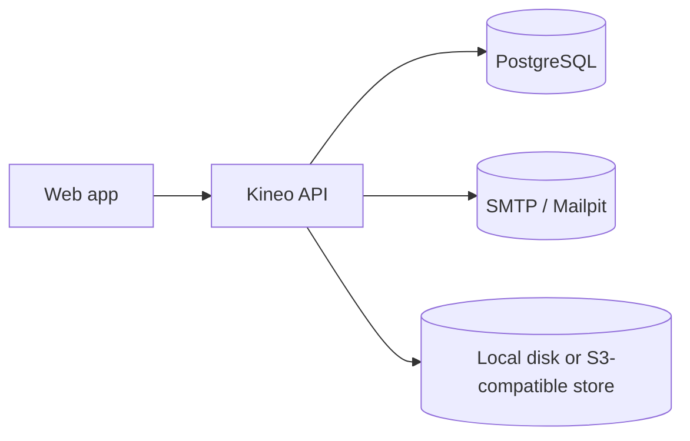

# Kineo - Backend

Kineo connects established doctors in France with locum doctors seeking replacements. Its distinguishing focus is administrative automation around contracts, identity verification, and status tracking rather than simple job listings.

This repository contains the backend: a NestJS API running on Bun, backed by PostgreSQL. It is the single authentication server for the platform; the Next.js frontend proxies `/api/auth/*` to it and does not implement authentication itself.

## At a glance

| | |
|---|---|
| Domain | Medical locum replacements in France |
| Runtime | Bun only; no Node process in the toolchain |
| Framework | NestJS 12, TypeScript |
| Persistence | PostgreSQL through Prisma 7 with `@prisma/adapter-pg` |
| Authentication | better-auth: email and password, sessions, optional bearer plugin |
| Validation | Zod through `nestjs-zod`; OpenAPI generated from the DTOs |
| Mail | Nodemailer over SMTP, with Mailpit in development |
| Files | Private objects served through authenticated routes; local disk or S3-compatible store |
| Status | MVP shipped; contracts, payments, ratings and messaging deferred |

## System context



The API owns every business rule: profile visibility, practice ownership, listing lifecycle, application transitions, and account erasure. The web app consumes it rather than duplicating that logic.

## Documentation

This README is the entry point. All detail lives in a self-contained documentation set under [`docs/`](docs/README.md).

| Area | Document | Covers |
|---|---|---|
| Product | [Overview](docs/product/overview.md) | Market, positioning, MVP perimeter |
| Product | [Roadmap](docs/product/roadmap.md) | Shipped work, next steps, deferred items |
| Architecture | [Overview](docs/architecture/overview.md) | Stack, modules, system diagram |
| Architecture | [Data model](docs/architecture/data-model.md) | Auth tables, entities, relationships |
| Architecture | [Domain flows](docs/architecture/flows.md) | Registration, publication, application, lifecycles |
| Guides | [Getting started](docs/guides/getting-started.md) | Setup, local services, commands |
| Guides | [Configuration](docs/guides/configuration.md) | Environment variables, limits, storage |
| Guides | [API](docs/guides/api.md) | Swagger, bearer tokens, route groups |
| Operations | [Security and reliability](docs/operations/security.md) | Access control, concurrency, throttling |
| Operations | [Testing and CI](docs/operations/testing.md) | Unit and e2e suites, drift gate |
| Operations | [Account erasure](docs/operations/account-erasure.md) | Anonymization, audit trail, purge |
| Reference | [Conventions](docs/reference/conventions.md) | Rules for the next reader |
| Reference | [AI takeover notes](docs/reference/ai-takeover.md) | Constraints for automated contributors |

## Quick start

Requires a PostgreSQL database reachable at `DATABASE_URL`.

```bash
bun install
cp .env.example .env
bun run db:migrate
bun run dev
```

The dev server listens on `PORT` (3000 by default), and Swagger is available at `/api` in development and test. See [Getting started](docs/guides/getting-started.md) for local services, seeding, and the full command list.

## Scope

The MVP covers registration, profiles and practices, publishing listings, search and apply, transparent application tracking, and the listing lifecycle. Contract generation, payments, real-time RPPS verification, ratings and messaging are out of scope. See [Product overview](docs/product/overview.md) for the reasoning.

## Companion repository

`kineo-next-frontend` is the web client of the platform. It is documented independently in its own repository, and this documentation set does not depend on it.

## Contributing

Before opening a pull request, run `bun run typecheck`, `bun run lint`, `bun run test`, and `bun run test:e2e`. CI also enforces a migration drift gate. See [Testing and CI](docs/operations/testing.md).
