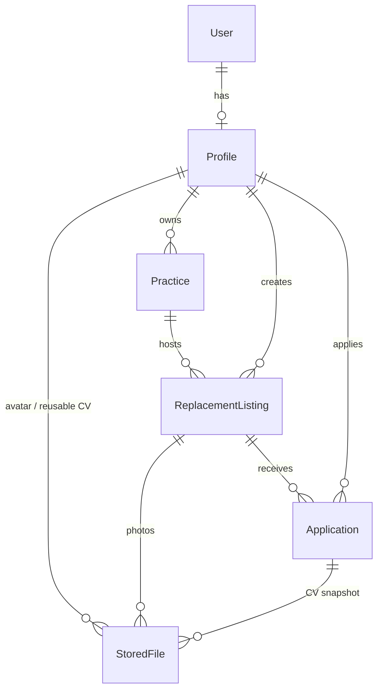

# Data model

[Documentation index](../README.md) - [Architecture overview](overview.md) - [Domain flows](flows.md)

The schema has two layers: better-auth's identity tables, which are generated and must not be edited by hand, and the business tables owned by this project.

## Better-auth tables

| Table | Role |
|---|---|
| `User` | Base identity: email, name, `emailVerified`, image |
| `Session` | Active sessions, managed by better-auth |
| `Account` | Credentials and password hashes, managed by better-auth |
| `Verification` | Verification, reset, and deletion tokens, managed by better-auth |
| `Jwks` | Present only when the optional JWT plugin is enabled with `JWT_ENABLED=true` |

> **Note** - Additional fields on `User` must be added through the better-auth CLI and regenerated. All business data belongs on `Profile`.

## Business entities

### Profile

| Field | Notes |
|---|---|
| `id` | Primary key |
| `userId` | Foreign key to `User` |
| `rppsNumber` | 11 digits, unique, optional |
| `specialty` | Enum |
| `profileType` | `INSTALLED`, `REPLACEMENT`, or `BOTH` |
| `verified` | Boolean |
| `isPublic` | Boolean |
| `city` | Text |
| `latitude`, `longitude` | Float |

### Practice

| Field | Notes |
|---|---|
| `id` | Primary key |
| `ownerId` | Foreign key to `Profile` |
| `name`, `address`, `city` | Text |
| `latitude`, `longitude` | Float |
| `isPublic` | Boolean |

Public coordinates are rounded to two decimals (about one kilometre); the exact values stay on the owner's `GET /profile/me`.

### ReplacementListing

| Field | Notes |
|---|---|
| `id` | Primary key |
| `practiceId` | Foreign key to `Practice` |
| `createdById` | Foreign key to `Profile` |
| `title`, `description` | Text |
| `startDate`, `endDate` | Datetime |
| `specialty` | Enum |
| `status` | `DRAFT`, `OPEN`, `IN_DISCUSSION`, `FULL`, `FILLED`, `CLOSED`, `CANCELLED` |
| `urgent` | Boolean |
| `maxApplications` | Optional cap on active applications |

### Application

| Field | Notes |
|---|---|
| `id` | Primary key |
| `listingId` | Foreign key to `ReplacementListing` |
| `applicantId` | Foreign key to `Profile` |
| `status` | `PENDING`, `SHORTLISTED`, `ACCEPTED`, `REJECTED`, `WITHDRAWN` |
| `message` | Applicant's message |
| `rejectionReason`, `withdrawnReason` | Explicit reasons shown to the other side |
| `viewedAt`, `respondedAt` | Transparent status timestamps |

### StoredFile

| Field | Notes |
|---|---|
| `id` | Primary key |
| `kind` | `AVATAR`, `LISTING_IMAGE`, or `CV` |
| `storageKey` | Storage disk key, unique |
| `originalName`, `mimeType` | Upload metadata |
| `size`, `position` | Bytes and ordering within a set |
| `uploaderId` | Foreign key to the uploader |
| `profileId`, `listingId`, `applicationId` | Optional linking fields |

Files stay private and are served through authenticated routes. The CV attached to an application is a `StorageDisk.copy()` snapshot: editing the candidate's reusable CV later never changes what a practice owner received. See [Configuration](../guides/configuration.md) for storage drivers.

## Not implemented

`Conversation` and `Message` were part of the original ERD. They are out of scope until a real need emerges; see the [Roadmap](../product/roadmap.md).

## Indexes

Composite and partial indexes follow the actual query patterns: status-filtered lookups on listings and applications, and bounding-box geo search on practices. The schema runs with `previewFeatures = ["partialIndexes"]` because the one-pending-request-per-fingerprint rule in account erasure relies on partial unique indexes. Check the Prisma release notes at every upgrade before touching that flag.
