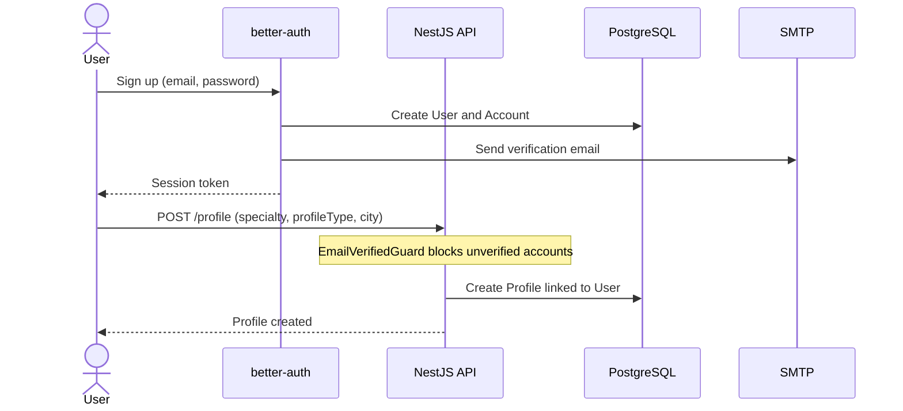
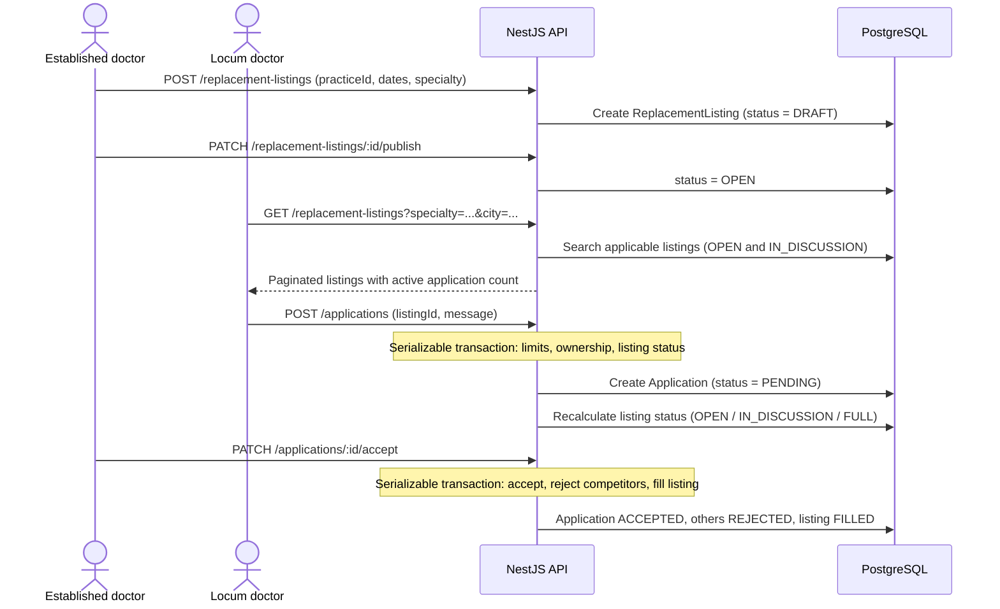
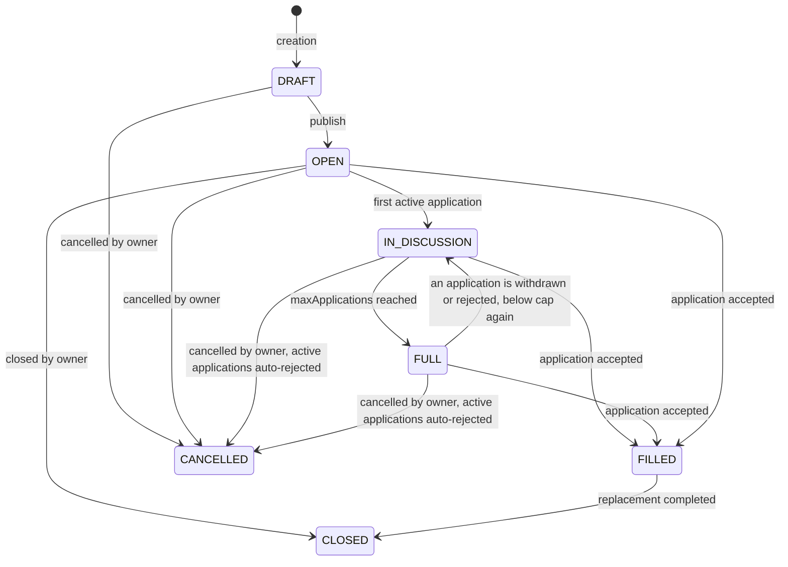
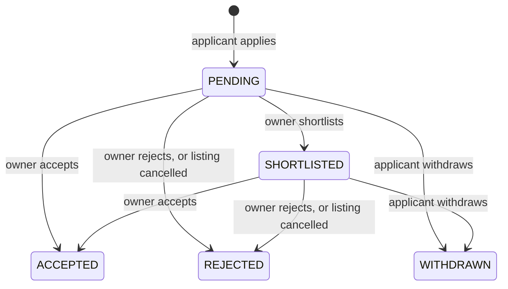

# Domain flows

[Documentation index](../README.md) - [Data model](data-model.md)

This page collects the four flows that define the product. All writes that touch shared counters are serializable transactions; see [Security and reliability](../operations/security.md).

## Registration and profile creation

### Email links

Links in better-auth emails, for verification and password reset, are rewritten to the frontend pages `/verify-email` and `/reset-password` with the `FRONTEND_URL` variable. Those pages complete the flow through `authClient`, which proxies `/api/auth/*` to this API. The API remains the single authentication server and its endpoints are unchanged.

The API also exposes a custom better-auth endpoint, `GET /api/auth/check-email-verification?token=...`. Given a verification token, including an expired or already used one, it reports whether the account is already verified. The `/verify-email` page uses it to display the success screen when a user clicks an old link again, and the signup page shows a "check your inbox" confirmation with a resend action.

## Listing publication and application

> **Note** - The browse feed answers the applicable set: `OPEN` and `IN_DISCUSSION`. A `FULL` posting is excluded by construction. `RECRUITING_LISTING_STATUSES` is a wider set used by the owner console; the gap is a product decision, not an accident. See [Conventions](../reference/conventions.md).

## Listing lifecycle

## Application lifecycle

> **Note** - Shortlist and message edits go through optimistic compare-and-set instead of a serializable transaction: the write carries the expected status in its `where` clause, and zero affected rows means the decision changed in between. The shortlist-versus-accept race is pinned over HTTP in `applications-transitions.e2e.test.ts`.
