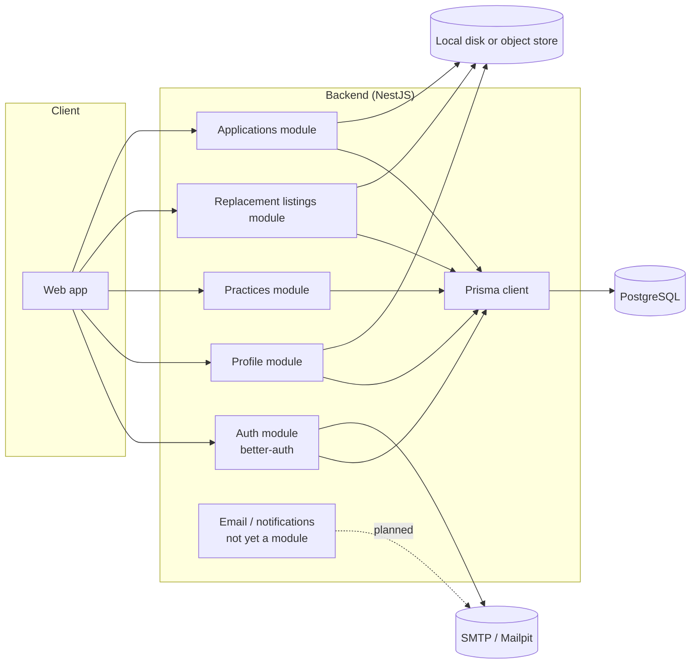

# Architecture overview

[Documentation index](../README.md) - [Data model](data-model.md) - [Domain flows](flows.md)

The backend is a single NestJS application. One database client serves the application and better-auth, and one authentication server serves the whole platform.

## Technology choices

| Area | Choice |
|---|---|
| Backend | NestJS 12 in TypeScript, executed by Bun |
| ORM | Prisma 7 with `provider = postgresql` and the `@prisma/adapter-pg` driver adapter |
| Authentication | better-auth: email and password, sessions, optional JWT plugin, email verification |
| Validation | Zod through `nestjs-zod`: DTOs, response serialization, generated OpenAPI schemas |
| Mail | Nodemailer over SMTP, with Mailpit for local development |
| Database | PostgreSQL |
| File storage | Official `@nestjs/storage` disks: a local folder or an S3-compatible RustFS store |
| Security | Helmet, `@nestjs/throttler` with several tiers, CORS, serializable transactions for concurrency-sensitive writes |
| Frontend | TanStack Router and React scaffolding only, documented in the separate frontend repository |

> **Note** - Bun is the only runtime. It runs the TypeScript sources directly in development, `tsc` is driven through `bun x`, and tests, the Prisma CLI, and the image all go through it. Nothing in the chain spawns Node.

## Modules

| Module | Responsibility |
|---|---|
| Auth | better-auth endpoints, sessions, verification and password reset emails |
| Profile | doctor profiles, visibility, RPPS format, public directory |
| Practices | practice CRUD and geo search |
| Replacement listings | listing CRUD, publishing, lifecycle, facets, places, pagination |
| Applications | applying, shortlisting, accept and reject cascade, withdrawal, view tracking, CV snapshots |
| Files | uploads, validation by magic number, authenticated streaming |
| Account deletion | anonymization endpoint and the keyed audit trail |
| Data lifecycle | hourly purge sweep under an advisory lock |
| Health | liveness and an optional deep readiness probe |
| Email and notifications | templates and mailer exist; not yet wired as a module |

> **Deferred** - Email notifications on status changes are written but not called from `ApplicationsService`. The intended home is a `NotificationsModule`.

## Layering rules

- Controllers are thin; guards belong on controllers, never on services. Nest guards do not run on plain service methods.
- All business data, including specialty, status, and location, lives on `Profile`, not on the better-auth `User` row.
- Ownership checks go through the shared helpers in `common/profile-lookup.ts` instead of repeating `findUnique` logic.
- Any read-then-write on a shared counter goes through `runSerializableTransaction` in `common/serializable-transaction.ts`.

See [Conventions](../reference/conventions.md) and [AI takeover notes](../reference/ai-takeover.md) for the full set of rules.
